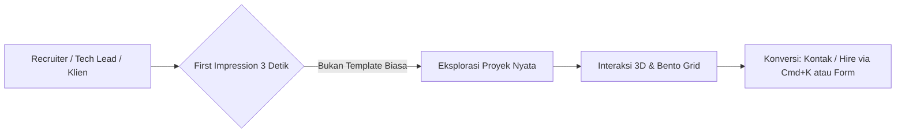
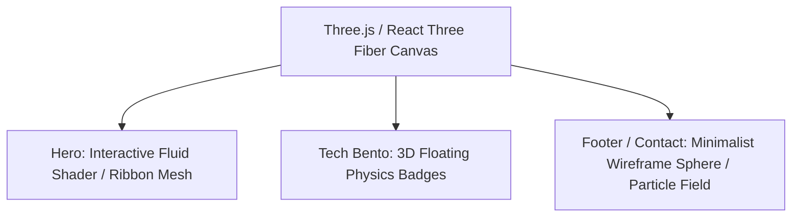

# Product Requirements Document (PRD)
## Ray Purba — Next-Gen 3D Portfolio Redesign (Anti-AI Slop Edition)

---

## 1. Executive Summary & Objective

### 1.1 Latar Belakang
Template portfolio 3D yang saat ini digunakan berbasis tutorial populer (*Three.js desktop PC model + background bintang + purple glow*). Pola ini telah menjamur di ribuan portfolio developer, menimbulkan **"Tutorial Fatigue"** dan rentan dinilai sebagai **"AI Slop"** (desain generik tanpa sentuhan rasa desainer/human craft).

### 1.2 Tujuan Proyek
Mentransformasikan portfolio personal Ray Purba menjadi web portfolio kelas dunia (standar *Awwwards / FWA / ReadCV*):
- **Unik & Berkarakter**: Memadukan estetika *Stealth Dark / High-End Editorial* dengan *Bento Grid Layout*.
- **3D Interaktif & Ringan**: Mengganti model GLTF berat dengan *Procedural/Shader 3D Art* atau *Interactive 3D Bento Physics* yang mulus di desktop maupun mobile.
- **Micro-Interactions Halus**: Mengintegrasikan *Inertia Smooth Scroll (Lenis)*, *Magnetic Controls*, dan *Command Palette (`Cmd+K`)*.
- **Bercerita (Storytelling)**: Proyek disajikan dengan bukti nyata (arsitektur, metrik performa, video preview), bukan sekadar kartu statis.

---

## 2. Target Persona & Value Proposition

- **Target Pengunjung**: Engineering Managers, CTOs, Design Engineers, dan Klien Internasional.
- **Kesan yang Ingin Dicapai**: *"Developer ini bukan sekadar penikmat tutorial atau prompt generator; ia paham seni interaksi, arsitektur modern, performa 60 FPS, dan craft visual tingkat tinggi."*

---

## 3. Design System & Visual Direction (Anti-AI Slop)

> [!IMPORTANT]
> Desain "Anti-AI Slop" menolak gradien ungu-neon klise dan font default. Fokus utama adalah kontras tajam, tipografi terkurasi, dan ruang negatif (*negative space*) yang bernafas.

### 3.1 Palet Warna ("Stealth Obsidian & Acid Pulse")

| Token | Nilai Hex | Peruntukan |
| :--- | :--- | :--- |
| `--bg-obsidian` | `#09090b` | Background utama kanvas & halaman |
| `--surface-card` | `#121216` | Background kartu Bento & panel interaktif |
| `--surface-border` | `rgba(255, 255, 255, 0.08)` | Border halus 1px kartu dengan efek glassmorphism |
| `--text-primary` | `#f4f4f5` | Heading utama, kontras tinggi |
| `--text-muted` | `#a1a1aa` | Paragraf sekunder, deskripsi teknis |
| `--accent-acid` | `#d4ff00` / `#00f5a0` | Aksen tajam (*high-visibility accents*, indikator status, hover highlights) |
| `--accent-glow` | `rgba(212, 255, 0, 0.12)` | Ambient glow halus pada interaksi fokus |

### 3.2 Tipografi
- **Display / Heading**: `Space Grotesk` atau `Syne` — tegas, geometris, berkarakter futuristik tanpa norak.
- **Body / Technical**: `Plus Jakarta Sans` atau `Geist Sans` — tingkat keterbacaan tinggi untuk deskripsi proyek & metrik.
- **Mono / Badge**: `JetBrains Mono` untuk stack teknologi, commit logs, dan terminal code.

---

## 4. Arsitektur 3D & Canvas Experience

### 4.1 Hero 3D Concept: *Fluid Mesh / Chromatic Ribbon*
- **Masalah Lama**: Model desktop PC GLTF (`desktop_pc/scene.gltf`) berat (>10MB), lambat di mobile, dan sangat pasaran.
- **Solusi Baru**: Kanvas WebGL kustom menggunakan **Simplex Noise / Ribbon Vertex Shader** yang responsif terhadap pergerakan mouse/touch.
  - Memantulkan warna aksen dengan efek *chromatic aberration* halus.
  - Ringan (<100KB), 60 FPS stabil di mobile.
  - Opsi alternatif: *Interactive 3D Terminal / Keyboard Element* yang tombolnya bereaksi saat ditekan.

### 4.2 Interactive Physics Tech Badges (Section Skills)
- Daripada bola 3D statis berlogo icon, gunakan kanvas fisika ringan (menggunakan `@react-three/fiber` + physics sederhana):
  - Badge teknologi berbentuk balok kaca/akrilik 3D yang dapat ditarik (*drag & drop*) dan saling bertabrakan secara natural.

---

## 5. Fitur & Spesifikasi Komponen

### 5.1 Hero Section
- **Status Indicator**: Badge aktif berkedip: `🟢 Available for freelance / full-time opportunities`.
- **Large Typographic Intro**: Statement berani dengan animasi staggered entry (Framer Motion).
- **Interactive Quick Actions**: Tombol magnetik *"Explore Works"* dan *"Quick Resume"*.

### 5.2 Bento Grid Showcase (Replacing Works & About)
Layout modular ala *Linear.app / Apple*:
1. **Featured Big Project Card**:
   - Preview interaktif (video looping otomatis saat di-hover).
   - Problem statement ringkas, solusi teknis, dan metrik dampak (*"Reduced API latency by 45%"*).
   - Live demo & source code links dengan magnetic pull.
2. **Architecture / Philosophy Card**:
   - Menampilkan visualisasi clean code / pipeline arsitektur.
3. **Interactive Playground / Code Snippet Card**:
   - Mini terminal interaktif yang bisa dijalankan.
4. **Current Focus / Listening To Card**:
   - Integrasi Spotify Live atau badge live time zone Jakarta (WIB).

### 5.3 Global Command Palette (`Cmd + K` / `Ctrl + K`)
- Modal pencarian cepat bergaya developer tool:
  - Navigasi instan ke section tertentu.
  - Copy email langsung ke clipboard (`raypurba@...`).
  - Ganti tema / toggle audio sound effects (opsional).
  - Download CV / Resume (PDF).

### 5.4 Experience & Journey
- Menggantikan timeline garis vertikal generik dengan **Interactive Milestones Ledger**:
  - Filter berdasarkan peran (*Full-Stack*, *Front-End*, *3D/Creative*).
  - Menampilkan pencapaian kuantitatif, bukan sekadar daftar tugas harian.

### 5.5 Contact Section & Footer
- Form kontak modern dengan validasi instan.
- Ambient particle canvas di latar belakang.
- Saluran sosial terkurasi dengan status ketersediaan.

---

## 6. Non-Functional Requirements & Performance

| Parameter | Target | Strategi |
| :--- | :--- | :--- |
| **Lighthouse Score** | ≥ 92 di Performance & Accessibility | Lazy load canvas Three.js di bawah lipatan, optimasi format asset (WebP/AVIF). |
| **FPS Stabilitas** | 60 FPS pada Desktop, min 50 FPS pada Mobile | Menggunakan procedural shader berbobot ringan, membatasi render loop saat tab tidak aktif. |
| **Smooth Scrolling** | Lenis Inertia Scroll | `requestAnimationFrame` terkoordinasi dengan Three.js ticker. |
| **Mobile Responsiveness** | Fallback graceful | Jika WebGL dideteksi berdaya rendah, canvas otomatis menyederhanakan jumlah shader/partikel. |

---

## 7. Roadmap Implementasi 4 Tahap

```mermaid
gantt
    title Roadmap Eksekusi Redesign Portfolio
    dateFormat  X
    axisFormat  Tahap %d

    section Tahap 1
    Design Tokens & Tipografi         :done, 0, 1
    Reset Warna & Tailwind Config     :done, 1, 2

    section Tahap 2
    Hero Section & New 3D Canvas      :active, 2, 4
    Inertia Scroll (Lenis) Integrasi  :3, 5

    section Tahap 3
    Bento Grid Projects & Works       :4, 7
    Interactive Tech Stack Physics    :6, 8

    section Tahap 4
    Command Palette (Cmd+K)           :7, 9
    Sound FX, Polish & Mobile Test    :8, 10
```

- **Fase 1: Foundation (Design System & Font)**
  - Konfigurasi font modern (`Space Grotesk` + `Plus Jakarta Sans`).
  - Pembaruan palet warna obsidian di [tailwind.config.js](file:///d:/FORTOFOLIO/raypurba-3d/tailwind.config.js) dan [globals.css](file:///d:/FORTOFOLIO/raypurba-3d/src/globals.css).
- **Fase 2: The Core Hero & 3D Experience**
  - Pembuatan canvas 3D baru (Fluid Shader / Interactive Ribbon / Modern Object).
  - Implementasi Lenis smooth scroll.
- **Fase 3: Bento Grid Layout**
  - Rombak section `About` & `Works` menjadi Bento Grid interaktif.
  - Ganti dummy projects dengan proyek riil yang memiliki metrik dan video preview.
- **Fase 4: Micro-interactions & Final Polish**
  - Command Palette (`Ctrl + K`).
  - Magnetic buttons & custom cursor.
  - Audit performa 60 FPS di desktop & mobile.

---

## 8. Pertimbangan Keputusan Desain (Design Decisions)
1. **Shader vs Model GLTF**: Memprioritaskan WebGL Shader prosedural karena ukurannya instan (<50KB), tidak memiliki resiko hak cipta model 3D, dan langsung memberikan aura desainer grafis kelas tinggi.
2. **Bento Grid vs Single Column**: Layout Bento memungkinkan variasi visual yang dinamis, menghindari kejenuhan kartu persegi berjejer biasa.
3. **No AI-Generated Clutter**: Semua copy, teks pengalaman, dan deskripsi proyek difokuskan pada problem-solving konkret manusia, bukan buzzword tanpa konteks.
